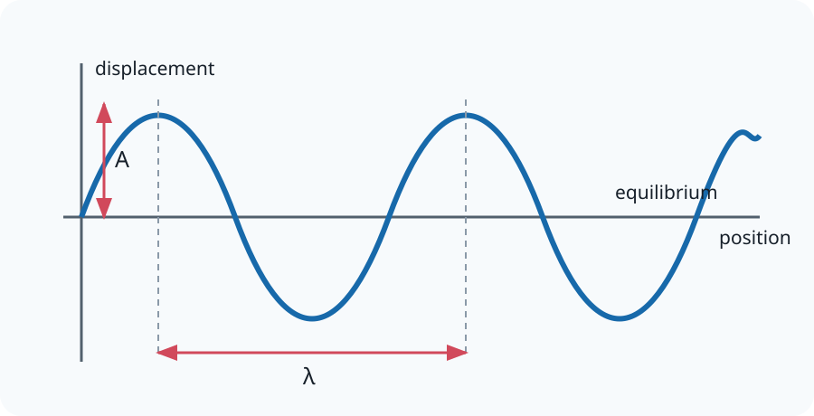

# 11.2 Wave Properties

[[00 11 Waves 1 Index|Topic index]] · [[00 Course Index|Course index]] · ← [[11.1 Progressive Waves|11.1 Progressive Waves]] · [[11.3 Reflection and Refraction|11.3 Reflection and Refraction]] →

> [!summary] Lesson purpose
> This lesson develops progressive waves.
> Source: [11.2 Wave Properties.pptx](<../../All Powerpoints/11 Waves 1/11.2 Wave Properties.pptx>) · 34 slides

> [!method] Calculation routine
> Use [[Equation Solving Method]]: list known quantities, convert to SI, state the equation, rearrange, substitute with units, and round at the end.

## Core notes

### 11.2 Wave Properties

*Source slide 1.*

- A [[Glossary#Progressive Wave|progressive wave]] is an oscillation (vibration) that transfers [[Glossary#Energy|energy]] but does not transfer matter.
- Mechanical waves need a medium to travel through.
- EM waves can travel through a vacuum.
- Transverse waves are when energy is transported perpendicular to the direction oscillation.
- Longitudinal waves are when energy is transported parallel to the direction oscillation.

### Wave Properties

*Source slide 3.*

- [[Glossary#Amplitude|Amplitude]], A: The maximum [[Glossary#Displacement|displacement]] from the rest (equilibrium) position.
- Units are meters (m).

### Frequency and Time Period

*Source slides 6–9.*

- [[Glossary#Frequency|Frequency]], f: The number of waves passing a point per unit time.
- Units are Hertz (Hz) or per second (s-1).
- Time Period, T: The time taken for a wave to move past a given point or the time taken for one oscillation.
- Units are seconds (s).
- Frequency and time period are inversely proportional.
- We can construct a new equation for wave [[Glossary#Velocity|velocity]] with time period instead of frequency.

### The Wave Speed Equation

*Source slide 8.*

- From the quantities listed on the previous slide we can construct an equation that can determine the wave’s speed.

### Phase Difference

*Source slides 11–12.*

- We need a way to describe different points of a wave and how they relate to each other.
- We do this with phase differences.
- The phase difference describes the difference between different displacements along a wave or the difference in displacements of different waves.
- Waves are oscillations therefore we describe the difference between waves with the use of angles in radians.

### Phase Difference: In Phase

*Source slide 13.*

- If a part of the wave continually has the same displacement this is called being in phase.

### Phase Difference: Antiphase

*Source slide 14.*

- If a part of the wave continually has the opposite displacement this is called being antiphase.

### The wave has a period of 4 s. Draw it after two seconds.

*Source slide 19.*

- The wave has a period of 4 s.

## Equations

### Progressive waves

$$v=f\lambda$$

Wave speed.

$$f=\frac{1}{T}$$

Frequency and period.

$$\Delta\phi=2\pi\frac{\Delta x}{\lambda}=2\pi\frac{\Delta t}{T}$$

Phase difference in radians.

See [[Formula Sheet]] for the complete course formula set.

## Method

1. Measure wavelength between neighbouring points in the same phase.
2. Keep particle motion separate from the direction of energy transfer.
3. Use peak amplitude, not peak-to-peak displacement, unless instructed otherwise.

## Common mistakes

- Wave speed is not the speed of oscillating particles in the medium.

## Additional examinable detail from the slides

> [!info]
> These collapsed slide notes retain assessable definitions, explanations, PowerPoint calculation steps, source tables and useful speaker-note detail that are not already stated in the concise sections above. Classroom administration, duplicate prompts, source credits and raw numerical answer lines are omitted.

> [!note]- Slide 3: Wave Properties
>
> **Exam-relevant speaker-note detail**
> - Frequency – Number of times something happens in a given time.
> - Number of complete waves /cycles per second.

> [!note]- Slide 4: Wave Properties
> - [[Glossary#Wavelength|Wavelength]], λ: The minimum distance between two points in phase on adjacent waves.
>
> **Exam-relevant speaker-note detail**
> - A wavelength is between any two points that repeat.

> [!note]- Slide 6: Frequency and Time Period
> - This can be described with a bus analogy.

> [!note]- Slide 8: The Wave Speed Equation
> - v = f λ

> [!note]- Slide 11: Phase Difference
>
> **Exam-relevant speaker-note detail**
> - The red points doing up and down.

> [!note]- Slide 12: Phase Difference
> - 360 degrees = 2π radians 180 degrees = π radians
> - 90 degrees = π/2 radians 45 degrees = π/4 radians

> [!note]- Slide 13: Phase Difference: In Phase
> - The wave will have a phase difference of 0 or multiples of 2π radians.

> [!note]- Slide 14: Phase Difference: Antiphase
> - The wave will have a phase difference of π or odd multiples of π radians.

> [!note]- Slide 15: Phase Difference: Antiphase
> - These waves are out of phase by 90 degrees = π/2 radians.

> [!note]- Slide 18: Homework Questions
> - Plan an experiment to determine the frequency of sound emitted from a constant source.

## Source slide route

> [!info]- Expand the original lesson sequence
> - 1. 11.2 Wave Properties
> - 2. Outcomes
> - 3. Wave Properties
> - 6. Frequency and Time Period
> - 7. Key Points
> - 8. The Wave Speed Equation
> - 9. Frequency and Time Period
> - 10. Example: Wave Frequency and Wavelength
> - 11. Phase Difference
> - 13. Phase Difference: In Phase
> - 14. Phase Difference: Antiphase
> - 16. Phase Difference Video
> - 17. Phase Difference Equation
> - 18. Homework Questions
> - 19. The wave has a period of 4 s. Draw it after two seconds.
> - 20. Answers
> - 21. Homework Answers
> - 25. The wave has a period of 4 s. Draw it after two seconds.
> - 26. Summary Questions
> - 28. Extension Work and Questions
> - 30. Summary Question Answers
> - 32. Extension Question Answers

## Related reference notes

- [[Glossary]]
- [[Formula Sheet]]
- [[SI Units, Prefixes and Significant Figures]]
- [[Graphs, Gradients and Data Skills]]
- [[Practical Skills and Uncertainties]]
