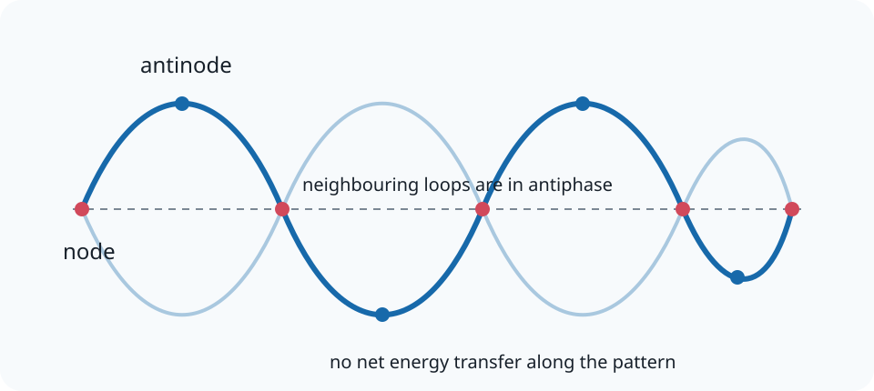

# 12.4 Stationary Waves

[[00 12 Waves 2 Index|Topic index]] · [[00 Course Index|Course index]] · ← [[12.3 Double Slit Experiment|12.3 Double Slit Experiment]] · [[12.5 Harmonics|12.5 Harmonics]] →

> [!summary] Lesson purpose
> This lesson develops stationary waves and harmonics and progressive waves.
> Source: [12.4 Stationary Waves.pptx](<../../All Powerpoints/12 Waves 2/12.4 Stationary Waves.pptx>) · 27 slides

> [!method] Calculation routine
> Use [[Equation Solving Method]]: list known quantities, convert to SI, state the equation, rearrange, substitute with units, and round at the end.

## Core notes

### 12.4 Stationary Waves

*Source slide 1.*

- When conducting the double slit experiment a filament lamps is used as a light source and we need to use a single slit and a coloured filter.
- A laser source can produce a single [[Glossary#Wavelength|wavelength]] with a constant phase difference.

### Unidentified Objects?

*Source slide 3.*

- The effect of stationary waves can be seen in nature.
- Some people, with vivid imaginations and lack of scientific understanding, see these lenticular clouds, formed by stationary waves, as UFOs.

### Stationary Waves

*Source slides 4–5.*

- A stationary (standing) wave is not a single wave.
- It is formed when two or more waves are superposed.
- If the waves have the same [[Glossary#Frequency|frequency]] at certain points they are in antiphase and the [[Glossary#Displacement|displacement]] cancels outs.
- While at other times the are in phase and the [[Glossary#Amplitude|amplitude]] increases.
- Now we need to image these waves progressive waves extended outwards in space.
- Or alternatively they are placed between two boundaries.
- Then these waves produce a periodic pattern that we can observe.

### Wavelength of Standing Waves

*Source slide 7.*

- Student Task: Using the term [[Glossary#Node|node]] (or antinode) create a word definition explaining the wavelength of a standing wave.
- The wavelength is twice the distance between adjacent nodes (or [[Glossary#Antinodes|antinodes]]).
- This is equal to the wavelength of the [[Glossary#Progressive Wave|progressive wave]] that created the [[Glossary#Stationary Wave|stationary wave]].

### Phase Differences and Standing Waves?

*Source slide 8.*

- The parts of the wave in red are in phase with each other and out of phase with the parts in purple.
- All points within a region of a two node are in phase with each other.
- For example, points A, B and C are also considered to be in phase with each other.

### Forming a stationary wave using microwaves

*Source slides 13–16.*

- A stationary wave can be formed by reflection microwaves off a metal sheet.
- As this means that two microwaves of the same frequency are travelling in opposite directions.
- A microwave receiver will detect changes in [[Glossary#Intensity|intensity]] between the nodes and antinodes.
- The distance between the transmitter and metal sheet has to be adjusted until the reviver detects a series of nodes or antinodes.
- In pairs answer the following questions.
- Be prepared to share your answers with the class.
- If the frequency of the microwaves used in the experiment is 5.0 GHz, calculate the distance between the adjacent node.

## Equations

### Stationary waves and harmonics

$$f_n=\frac{nv}{2L}\quad(n=1,2,3,\ldots)$$

String or open-open air column.

$$f_n=\frac{nv}{4L}\quad(n=1,3,5,\ldots)$$

Closed-open air column.

### Progressive waves

$$v=f\lambda$$

Wave speed.

$$f=\frac{1}{T}$$

Frequency and period.

$$\Delta\phi=2\pi\frac{\Delta x}{\lambda}=2\pi\frac{\Delta t}{T}$$

Phase difference in radians.

See [[Formula Sheet]] for the complete course formula set.

## Method

1. Mark boundary conditions first: fixed/closed ends are displacement nodes; open ends are displacement antinodes.
2. Count quarter- or half-wavelength sections to relate \(L\) and \(\lambda\).
3. Use \(v=f\lambda\) after finding the allowed wavelength.
4. Measure wavelength between neighbouring points in the same phase.
5. Keep particle motion separate from the direction of energy transfer.
6. Use peak amplitude, not peak-to-peak displacement, unless instructed otherwise.

## Common mistakes

- A stationary wave transfers no net energy along the pattern.
- Adjacent points between the same two nodes oscillate in phase; neighbouring loops are in antiphase.
- Wave speed is not the speed of oscillating particles in the medium.

## Additional examinable detail from the slides

> [!info]
> These collapsed slide notes retain assessable definitions, explanations, PowerPoint calculation steps, source tables and useful speaker-note detail that are not already stated in the concise sections above. Classroom administration, duplicate prompts, source credits and raw numerical answer lines are omitted.

> [!note]- Slide 1: 12.4 Stationary Waves
>
> **Exam-relevant speaker-note detail**
> - To form a [[Glossary#Coherent|coherent]] light source where the phase difference of the waves is continuous.

> [!note]- Slide 5: Stationary Waves
> - Nodes are points when there is no displacement and this is always zero.
> - Antinode is formed when the amplitude is the greatest.

> [!note]- Slide 10: Displacement / m
> - t = 0
> - t = T/4
> - t = T/2
> - t = 3T/4
> - t = T

> [!note]- Slide 11: Progressive and Stationary Waves
>
> |  | Progressive Wave | Stationary Wave |
> |---|---|---|
> | Energy Transfer | Energy transferred in the direction of the wave | No net energy transfer |
> | Wavelength | Minimum displacement between two adjacent points oscillation in phase. | Twice the distance between adjacent nodes. This is equal to the wavelength of the progress waves that created the stationary wave. |
> | Phase difference | The phase changes across one complete cycle of the wave | All parts of the wave between nodes are in phase. |
> | Amplitude | All partis of the wave have the same amplitude | Maximum amplitude at the antinodes and zero at the nodes. |

> [!note]- Slide 14: Forming a stationary wave using microwaves
> - The distance between successive nodes or antinodes is equal to λ/2 where λ is the wavelength of the microwave form the transmitter.

> [!note]- Slide 16: Forming a stationary wave using microwaves
> - This is equal to half of the wavelength.
> - Then multiply the average distance by a factor of two.

> [!note]- Slide 22: Homework Answers
> - The two waves are in antiphase at the node and they are in phase at the antinode.

> [!note]- Slide 23: Homework Answers
> - Therefore, λ = 2 x 30 cm = 60 cm = 0.60 m (2 sf).

> [!note]- Slide 24: Homework Answers
> - As you move towards the antinode the amplitude increases.

## Source slide route

> [!info]- Expand the original lesson sequence
> - 1. 12.4 Stationary Waves
> - 2. Outcomes
> - 3. Unidentified Objects?
> - 4. Stationary Waves
> - 6. Pop Quiz
> - 7. Wavelength of Standing Waves
> - 8. Phase Differences and Standing Waves?
> - 9. Demonstration
> - 10. Displacement / m
> - 11. Progressive and Stationary Waves
> - 12. Task: Comparison of waves
> - 13. Forming a stationary wave using microwaves
> - 18. Homework Questions
> - 19. Answers
> - 20. Homework Answers

## Related reference notes

- [[Glossary]]
- [[Formula Sheet]]
- [[SI Units, Prefixes and Significant Figures]]
- [[Graphs, Gradients and Data Skills]]
- [[Practical Skills and Uncertainties]]
