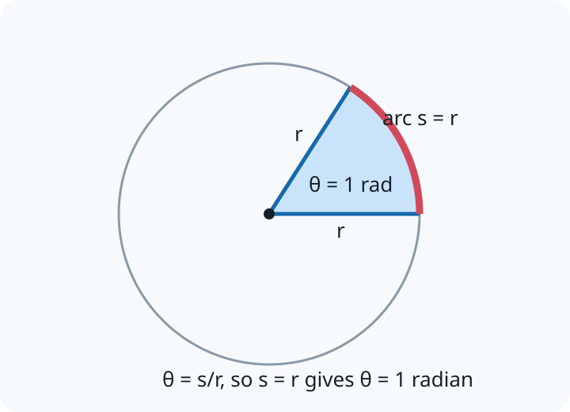

# 16.1 Angular velocity and the radian

[[00 16 Circular Motion Index|Topic index]] · [[00 Course Index|Course index]] · ← [[15.4 The Boltzmann Constant|15.4 The Boltzmann Constant]] · [[16.2 Angular Acceleration|16.2 Angular Acceleration]] →

> [!summary] Lesson purpose
> This lesson develops radians and angular motion.
> Source: [16.1 Angular velocity and the radian.pptx](<../../All Powerpoints/16 Circular Motion/16.1 Angular velocity and the radian.pptx>) · 20 slides

> [!method] Calculation routine
> Use [[Equation Solving Method]]: list known quantities, convert to SI, state the equation, rearrange, substitute with units, and round at the end.

## Core notes

### The Radian Definition

*Source slide 3.*

- Therefore, we will derive a new rational measure of angle called the [[Glossary#Radian|radian]].
- This will be based upon a physical quantity of the circle, the radius.

### Example Angular Motion

*Source slide 7.*

- A spinning top completes 8.0 full revolutions before it comes to rest.
- Express the angle it moves through in degrees and radians.

### Angular Velocity

*Source slide 8.*

- To describe a particle's motion we need to be able to do this linearly and also with rotation.

## Equations

### Radians and angular motion

$$s=r\theta$$

Arc length; \(\theta\) must be in radians.

$$\omega=\frac{\Delta\theta}{\Delta t}=\frac{2\pi}{T}=2\pi f$$

Angular velocity.

$$v=\omega r$$

Linear speed.

See [[Formula Sheet]] for the complete course formula set.

## Method

1. Convert angles to radians before using rotational equations.
2. Use the same time interval when connecting angular and linear motion.

## Common mistakes

- Angular speed is shared by points on a rigid rotating object, but linear speed increases with radius.

## Additional examinable detail from the slides

> [!info]
> These collapsed slide notes retain assessable definitions, explanations, PowerPoint calculation steps, source tables and useful speaker-note detail that are not already stated in the concise sections above. Classroom administration, duplicate prompts, source credits and raw numerical answer lines are omitted.

> [!note]- Slide 1: 16.1 Angular Velocity and the Radian
> - If you have a good understanding of these two equations then the following lesson will be a simple extension.

> [!note]- Slide 3: The Radian Definition
> - The exact reason we split a circle in to 360 segments and call these degrees is a historical note when civilisations such as the ancient Egyptians, the Maya, and the Babylonians determined there to be 360 days in the year.
> - Yet, scientifically today there is no apparent reason to continue to do so.

> [!note]- Slide 4: The Radian and Arc Length
> - Therefore, 360o is equal to 2π rads.

> [!note]- Slide 6: Exercise: Conversions
> - Convert these angles from degrees to radians.
> - = 2 π rads
> - = π rads
> - = π/3 rads
> - = π/6 rads
> - = π/12 rads
> - = π/180 rads

> [!note]- Slide 7: Example Angular Motion
> - Degrees: 360o x 8.0 = 2880o
> - Radians: 2π x 8.0 = 50 rads

> [!note]- Slide 8: Angular Velocity
> - This may seem daunting at first but if we apply the same logic as we did with the simple equation speed = distance / time we should have some success.
> - [[Glossary#Velocity|Velocity]] tells us how distance changes with time and angular velocity, ω, is going to tell us how angle changes with time.

> [!note]- Slide 9: Angular Velocity
> - By definition the particle moves through one rotation (2 π) equal to time being one time period T.
> - As [[Glossary#Frequency|frequency]] is the reciprocal of the time period we arrive at,

> [!note]- Slide 11: Homework Questions
> - Assuming each hand moves at a constant rate, calculate the angular velocity of each hand.

## Source slide route

> [!info]- Expand the original lesson sequence
> - 1. 16.1 Angular Velocity and the Radian
> - 2. Outcomes
> - 3. The Radian Definition
> - 4. The Radian and Arc Length
> - 5. Worked Example: Conversions
> - 6. Exercise: Conversions
> - 7. Example Angular Motion
> - 8. Angular Velocity
> - 10. Worked Example
> - 11. Homework Questions
> - 12. Answers
> - 13. Homework Answers

## Related reference notes

- [[Glossary]]
- [[Formula Sheet]]
- [[SI Units, Prefixes and Significant Figures]]
- [[Graphs, Gradients and Data Skills]]
- [[Practical Skills and Uncertainties]]
