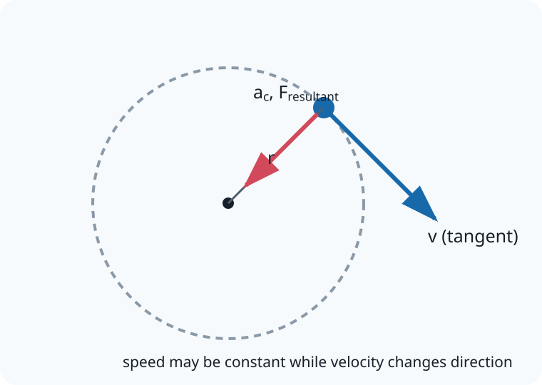

# 16.3 Centripetal Forces

[[00 16 Circular Motion Index|Topic index]] · [[00 Course Index|Course index]] · ← [[16.2 Angular Acceleration|16.2 Angular Acceleration]] · [[17.1 Oscillations and SHM|17.1 Oscillations and SHM]] →

> [!summary] Lesson purpose
> This lesson develops radians and angular motion, centripetal acceleration and force, and forces and Newton's laws.
> Source: [16.3 Centripetal Forces.pptx](<../../All Powerpoints/16 Circular Motion/16.3 Centripetal Forces.pptx>) · 25 slides

> [!method] Calculation routine
> Use [[Equation Solving Method]]: list known quantities, convert to SI, state the equation, rearrange, substitute with units, and round at the end.

## Core notes

### 16.3 Centripetal Force

*Source slide 1.*

- The [[Glossary#Force|force]] keeping the object in a circular motion is called the centripetal (centre seeking) force.

### Investigating Circular Motion

*Source slide 4.*

- The greater the centripetal force the greater the mass is moved through the gravitational field.

### Separating Samples: Centrifuge

*Source slides 6–7.*

- In 1864, Antonin Prandtl invented the first centrifuge in order to separate cream from milk.
- Centrifuges are now used widely in science, medicine, and industry, for example to separate the components of blood.
- The centrifuge works by spinning liquids at very high speeds.
- Particles in the liquids with a greater mass require a greater centripetal force to follow the circular path and move outwards to the bottom of the tube.
- The lighter particles end up near the top of the tube.
- A centrifuge spins at 6000 rpm.

### Banked Corners in Sport

*Source slide 8.*

- Indoor cycling and track racing for cars utilise banked corners to ensure that they can travel at fast speeds.
- The faster one goes the greater the force required to maintain yourself on the same circular path.
- Banked tracks allows a component of the weight to contribute to the centripetal force and therefore allows the riders to travel at a faster speed for the same circular path.

## Equations

### Radians and angular motion

$$s=r\theta$$

Arc length; \(\theta\) must be in radians.

$$\omega=\frac{\Delta\theta}{\Delta t}=\frac{2\pi}{T}=2\pi f$$

Angular velocity.

$$v=\omega r$$

Linear speed.

### Centripetal acceleration and force

$$a_c=\frac{v^2}{r}=\omega^2r$$

Centripetal acceleration.

$$F_c=\frac{mv^2}{r}=m\omega^2r$$

Resultant inward force.

### Forces and Newton's laws

$$\sum F=ma$$

Resultant force causes acceleration.

$$W=mg$$

Weight in a gravitational field.

See [[Formula Sheet]] for the complete course formula set.

## Method

1. Convert angles to radians before using rotational equations.
2. Use the same time interval when connecting angular and linear motion.
3. Identify the real forces, then set their inward resultant equal to \(mv^2/r\).
4. Centripetal force is a role played by real forces, not an extra force.
5. Isolate the object and draw only forces acting on it.
6. Choose axes, resolve forces if needed, then write \(\sum F=ma\) along each axis.
7. For equilibrium or constant velocity, set the resultant force to zero.

## Common mistakes

- Angular speed is shared by points on a rigid rotating object, but linear speed increases with radius.
- Velocity is tangential while acceleration and resultant force point toward the centre.
- Newton's third-law pair acts on different objects, so the two forces do not cancel on one free-body diagram.
- Mass is measured in kilograms; weight is a force measured in newtons.

## Additional examinable detail from the slides

> [!info]
> These collapsed slide notes retain assessable definitions, explanations, PowerPoint calculation steps, source tables and useful speaker-note detail that are not already stated in the concise sections above. Classroom administration, duplicate prompts, source credits and raw numerical answer lines are omitted.

> [!note]- Slide 1: 16.3 Centripetal Force
> - As we know that v = rω we can also arrive at,

> [!note]- Slide 4: Investigating Circular Motion
>
> **Exam-relevant speaker-note detail**
> - Take g = 10 N/kg. f The force F may be varied by adding more washers.

> [!note]- Slide 5: Worked Example
> - Step One: State what you know and convert the units
> - Step Two: State equation and rearrange

> [!note]- Slide 7: Separating Samples: Centrifuge
>
> **Exam-relevant speaker-note detail**
> - F = mw^2r
> - R = (F)/(mw^2) = 7.6 m.,

> [!note]- Slide 9: Homework Questions
> - D) The radius halves and the speed decreases by a factor of two.

## Source slide route

> [!info]- Expand the original lesson sequence
> - 1. 16.3 Centripetal Force
> - 2. Outcomes
> - 3. Centripetal Force
> - 4. Investigating Circular Motion
> - 5. Worked Example
> - 6. Separating Samples: Centrifuge
> - 8. Banked Corners in Sport
> - 9. Homework Questions
> - 11. Answers
> - 12. Homework Answers

## Related reference notes

- [[Glossary]]
- [[Formula Sheet]]
- [[SI Units, Prefixes and Significant Figures]]
- [[Graphs, Gradients and Data Skills]]
- [[Practical Skills and Uncertainties]]
