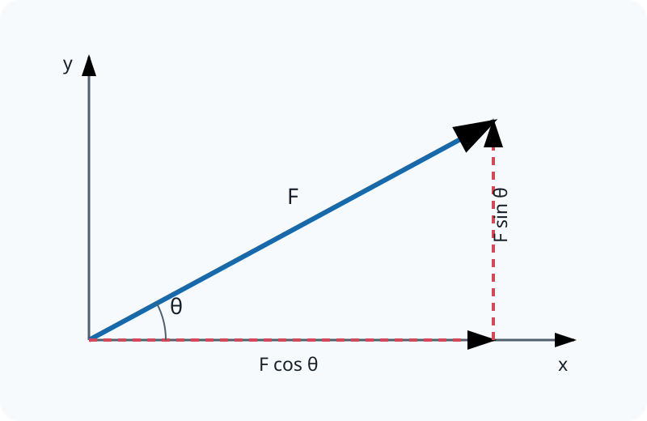

# 2.5 Resolving Vectors

[[00 2 Foundations of Physics Index|Topic index]] · [[00 Course Index|Course index]] · ← [[2.4 Adding Vectors|2.4 Adding Vectors]] · [[2.6 More Vectors|2.6 More Vectors]] →

> [!summary] Lesson purpose
> This lesson develops vectors and components.
> Source: [2.5 Resolving Vectors.pptx](<../../All Powerpoints/2 Foundations of Physics/2.5 Resolving Vectors.pptx>) · 25 slides

> [!method] Calculation routine
> Use [[Equation Solving Method]]: list known quantities, convert to SI, state the equation, rearrange, substitute with units, and round at the end.

## Core notes

### 2.5 Resolving Vectors

*Source slide 1.*

- 1) i) Construct a scaled drawing of the following vectors: [[Glossary#Vector|vector]] up 6.0 N add vector right 3.0 N.
- ii) Find the magnitude of the resultant vector. iii) Label and determine the magnitude of angle for the resultant vector.

### Adding and Resolving

*Source slide 3.*

- So far we have seen how vectors can be added together to create a resultant vector.
- Resolving vectors is splitting a vector into its different components.
- Given a vector we ask ourselves how far along the x axis do we go and how far along the y axis do we need to go.

### Trigonometry and Vectors

*Source slide 4.*

- We need to know these trigonometric identities very well to succeed at A level physics.

## Equations

### Vectors and components

$$F_x=F\cos\theta$$

Component adjacent to the stated angle.

$$F_y=F\sin\theta$$

Component opposite the stated angle.

$$R=\sqrt{R_x^2+R_y^2}$$

Magnitude from perpendicular components.

$$\theta=\tan^{-1}\!\left(\frac{R_y}{R_x}\right)$$

Direction from perpendicular components; check the quadrant.

See [[Formula Sheet]] for the complete course formula set.

## Method

1. Choose positive directions and draw a labelled sketch.
2. Resolve every vector along the same pair of perpendicular axes.
3. Add components with signs, then find the magnitude and direction of the resultant.

## Common mistakes

- A negative component means the vector points opposite to the chosen positive direction.
- State directions with the final magnitude; a magnitude alone is not a complete vector answer.

## Additional examinable detail from the slides

> [!info]
> These collapsed slide notes retain assessable definitions, explanations, PowerPoint calculation steps, source tables and useful speaker-note detail that are not already stated in the concise sections above. Classroom administration, duplicate prompts, source credits and raw numerical answer lines are omitted.

> [!note]- Slide 1: 2.5 Resolving Vectors
> - a2 + b2 = h2
> - 62 + 32 = h2
> - h2 = 45
> - h = 6.708…N
> - h = 6.7 N (2 sf)
> - = 26.565…o
> - = 27o (2 sf)

> [!note]- Slide 3: Adding and Resolving
> - Today we will look at how to resolve (decompose) vectors into x and y directions.

> [!note]- Slide 5: Trigonometry and Vectors
> - F sin ѳ
> - Fy =
> - Fx =

> [!note]- Slide 6: Worked Example 1: Windy Airports
> - Step One: Draw a diagram and label
> - Step Two: State trig identity, substitute and calculate
> - vy = v sin ѳ

> [!note]- Slide 7: Worked Example 1: Windy Airports
> - vx = v cos ѳ

> [!note]- Slide 8: Worked Example 1: Windy Airports
> - Step Three: Check the results with Pythagoras’ theorem

> [!note]- Slide 9: Worked Example 2: Ball on a hill
> - Step Two: Draw the [[Glossary#Normal|normal]] and label the angles
> - Step Three: State trigonometric identities, substitute and calculate

> [!note]- Slide 10: Worked Example 2: Ball on a hill
> - Step Three: State trig identities, substitute and calculate

> [!note]- Slide 13: Worked Example 4: Force on the box
> - Step One: Identify the correct component & label the triangle
> - Step Two: State trigonometric identities, substitute and calculate
> - From Newton’s second law: F = ma

## Source slide route

> [!info]- Expand the original lesson sequence
> - 1. 2.5 Resolving Vectors
> - 2. Outcomes
> - 3. Adding and Resolving
> - 4. Trigonometry and Vectors
> - 6. Worked Example 1: Windy Airports
> - 9. Worked Example 2: Ball on a hill
> - 11. Worked Example 3: Box on a hill
> - 13. Worked Example 4: Force on the box
> - 14. Homework Questions
> - 15. Answers
> - 16. Homework Answers
> - 23. Additional Slides

## Related reference notes

- [[Glossary]]
- [[Formula Sheet]]
- [[SI Units, Prefixes and Significant Figures]]
- [[Graphs, Gradients and Data Skills]]
- [[Practical Skills and Uncertainties]]
