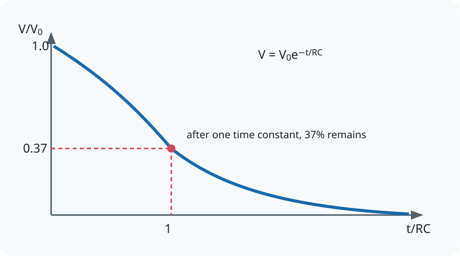

# 21.4 Discharging Capacitors

[[00 21 Capacitance Index|Topic index]] · [[00 Course Index|Course index]] · ← [[21.3 Energy and Capacitors|21.3 Energy and Capacitors]] · [[21.5 Charging Capacitors|21.5 Charging Capacitors]] →

> [!summary] Lesson purpose
> This lesson develops capacitor charging and discharging.
> Source: [21.4 Discharging Capacitors.pptx](<../../All Powerpoints/21 Capacitance/21.4 Discharging Capacitors.pptx>) · 40 slides

> [!method] Calculation routine
> Use [[Equation Solving Method]]: list known quantities, convert to SI, state the equation, rearrange, substitute with units, and round at the end.

## Core notes

### Exponentials

*Source slide 5.*

- The term exponential is used in everyday speech to mean increases quickly.
- Exponential growth in science has a clear and specific definition.
- Exponential growth is when a system increases by the same factor in equal time intervals.
- Exponential decay is when a system decreases by the same factor in equal time intervals.
- The magic penny is an example where the factor is 2 and the time period is 1 day.

### Exponential Decay

*Source slide 6.*

- Exponential change is a common phenomenon in the natural world.
- It describes how [[Glossary#Pressure|pressure]] decreases with altitude, how radioactive samples decay, and how capacitors discharge their [[Glossary#Energy|energy]].

### Discharging a capacitor

*Source slides 9–20.*

- As the charge leaves the capacitor the [[Glossary#Potential Difference|potential difference]], charge, and current exponentially decay to zero.
- As the current is decreasing, we include a minus.
- You do not need to know this derivation for your exam.

### Time constant

*Source slide 16.*

- Since e is a function, the argument needs to be unitless.

### Time constant 𝜏

*Source slide 17.*

- As the [[Glossary#Time Constant|time constant]] increases, the capacitor takes longer to discharge.
- The time constant, 𝜏, for discharging a capacitor is equal to the time taken for the initial value to decrease to 37% (e-1).

### Modelling Decay

*Source slide 21.*

- This equation allows us to model how charge decays as a capacitor discharges.
- We use a technique called iterative modelling.

## Equations

### Capacitor charging and discharging

$$\tau=CR$$

Time constant.

$$x=x_0e^{-t/CR}$$

Discharge of \(Q,V\), or \(I\) magnitude.

$$x=x_0\left(1-e^{-t/CR}\right)$$

Charging rise for \(Q\) or capacitor voltage.

See [[Formula Sheet]] for the complete course formula set.

## Method

1. For exponential graphs, one time constant leaves \(e^{-1}\approx0.37\) of a decaying quantity.
2. Linearise discharge data using \(\ln x=\ln x_0-t/CR\).
3. State which quantity \(x\) represents; charging current decreases rather than rises.

## Common mistakes

- A capacitor voltage cannot change instantaneously in an ideal lumped circuit.

## Additional examinable detail from the slides

> [!info]
> These collapsed slide notes retain assessable definitions, explanations, PowerPoint calculation steps, source tables and useful speaker-note detail that are not already stated in the concise sections above. Classroom administration, duplicate prompts, source credits and raw numerical answer lines are omitted.

> [!note]- Slide 1: 21.4 Discharging Capacitors
> - Area = [[Glossary#Work Done|Work Done]]

> [!note]- Slide 2: Student Activity
> - We can substitute expression (b) into equation (1):
> - We can substitute (c) into equation (2)

> [!note]- Slide 4: Quick Question
> - You should pick the magic penny.
> - This is an example of exponential growth.

> [!note]- Slide 7: Student Activity
> - Give a natural example of exponential change.
> - Pressure decreases with altitude, radioactive samples decay, and how capacitors discharge

> [!note]- Slide 10: Exponential decay
> - This shows how potential difference changes with time for a capacitor of 425 µF discharging through a resistor of 85 kΩ.

> [!note]- Slide 11: Exponential decay
> - This shows how current changes with time for a capacitor of 425 µF discharging through a resistor of 85 kΩ.

> [!note]- Slide 12: Exponential decay
> - This shows how charge changes with time for a capacitor of 425 µF discharging through a resistor of 85 kΩ.

> [!note]- Slide 13: Student Activity
> - When a capacitor discharges through a resistor three quantities decrease.
> - Potential difference, current and charge.
> - These quantities will decrease to zero.
> - They decrease through exponential decay where the system decreases by the same factor in equal time intervals.

> [!note]- Slide 14: Mathematical Expressions
>
> **Exam-relevant speaker-note detail**
> - The final equation with x is the equation on the data sheet for the exam.

> [!note]- Slide 16: Time constant
> - You may have noticed that in the argument of the function e we have,

> [!note]- Slide 17: Time constant 𝜏
> - 2𝜏 = 72.25 s

> [!note]- Slide 18: Student Activity
> - [[Glossary#Capacitance|Capacitance]] of the capacitor and [[Glossary#Resistance|resistance]] of the resistor.

> [!note]- Slide 20: Discharging a Capacitor
>
> **Exam-relevant speaker-note detail**
> - Link to differential equations in A-level maths.

> [!note]- Slide 21: Modelling Decay
> - A solution to this equation is:

> [!note]- Slide 23: Iterative modelling
>
> **Exam-relevant speaker-note detail**
> - Very small = 1 % ish

## Source slide route

> [!info]- Expand the original lesson sequence
> - 1. 21.4 Discharging Capacitors
> - 2. Student Activity
> - 3. Outcomes
> - 4. Quick Question
> - 5. Exponentials
> - 6. Exponential Decay
> - 7. Student Activity
> - 8. Discharging a capacitor
> - 10. Exponential decay
> - 13. Student Activity
> - 14. Mathematical Expressions
> - 15. Worked Example
> - 16. Time constant
> - 17. Time constant 𝜏
> - 18. Student Activity
> - 20. Discharging a Capacitor
> - 21. Modelling Decay
> - 22. Solving Differential Equations
> - 23. Iterative modelling
> - 24. Worked Example
> - 26. Homework Questions
> - 29. Answers
> - 30. Homework Answers
> - 36. Homework Questions

## Related reference notes

- [[Glossary]]
- [[Formula Sheet]]
- [[SI Units, Prefixes and Significant Figures]]
- [[Graphs, Gradients and Data Skills]]
- [[Practical Skills and Uncertainties]]
