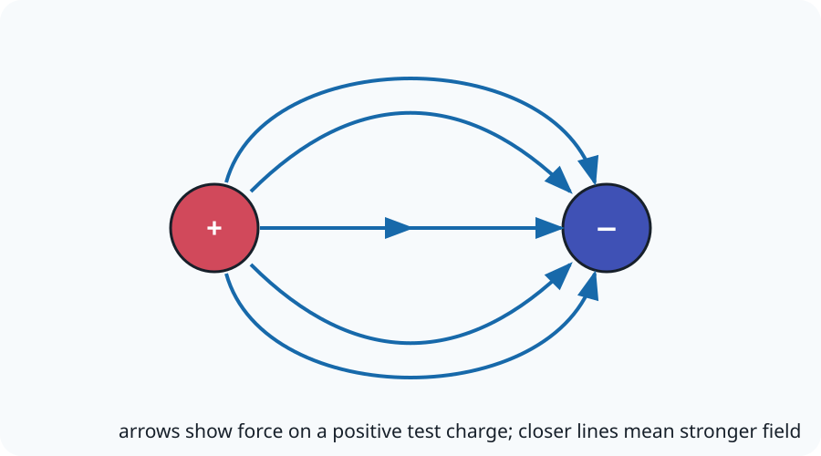

# 22.1 Electric Fields

[[00 22 Electric Fields Index|Topic index]] · [[00 Course Index|Course index]] · ← [[21.6 Use of Capacitors|21.6 Use of Capacitors]] · [[22.2 Coulomb's Law|22.2 Coulomb's Law]] →

> [!summary] Lesson purpose
> This lesson develops electric field strength.
> Source: [22.1 Electric Fields.pptx](<../../All Powerpoints/22 Electric Fields/22.1 Electric Fields.pptx>) · 28 slides

> [!method] Calculation routine
> Use [[Equation Solving Method]]: list known quantities, convert to SI, state the equation, rearrange, substitute with units, and round at the end.

## Core notes

### Electric Field Lines

*Source slides 3–4.*

- Charged particles produce electric field lines.
- Positive particles produce electric field lines that point outwards.
- Positive people radiate outwards with enthusiasm!
- Negative particles produce electric field lines that point inwards.
- Negative people suck up enthusiasm!

### Field Line Rules

*Source slide 5.*

- 2) The closer the field lines the greater the [[Glossary#Force|force]].

### Radial Fields

*Source slides 9–10.*

- A uniformly charged object also produces a radial electric field.
- A point charge produces a radial electric field.
- Uniformly charged objects can be viewed as a point charge.

### Capacitors & Electric Field Lines

*Source slide 11.*

- When a capacitor charges it gains more change on its plates.
- Charges on capacitor plates produce electric field lines.

### Interacting Field Lines

*Source slide 15.*

- The closer the field lines the greater the force.

### Detecting Electric Fields

*Source slide 17.*

- The strength of an electric fields can be tested using a charged gold leaf.
- The greater the angle between the charged gold leaf and the insulator the greater the electric field.

## Equations

### Electric field strength

$$E=\frac{F}{Q}$$

Electric field strength.

See [[Formula Sheet]] for the complete course formula set.

## Method

1. Define field direction as the force direction on a positive test charge.
2. Use superposition to add electric fields as vectors.

## Common mistakes

- A negative charge experiences force opposite to the electric-field direction.

## Additional examinable detail from the slides

> [!info]
> These collapsed slide notes retain assessable definitions, explanations, PowerPoint calculation steps, source tables and useful speaker-note detail that are not already stated in the concise sections above. Classroom administration, duplicate prompts, source credits and raw numerical answer lines are omitted.

> [!note]- Slide 1: 22.1 Electric Fields
>
> **Exam-relevant speaker-note detail**
> - They have different electron [[Glossary#Energy|energy]] levels

> [!note]- Slide 6: Student Activity
> - Electric field lines for negatively charged particles point inwards.

> [!note]- Slide 12: Student Activity
> - A uniformly charged object produces a radial electric field.

## Source slide route

> [!info]- Expand the original lesson sequence
> - 1. 22.1 Electric Fields
> - 2. Outcomes
> - 3. Electric Field Lines
> - 5. Field Line Rules
> - 6. Student Activity
> - 9. Radial Fields
> - 11. Capacitors & Electric Field Lines
> - 12. Student Activity
> - 14. Interacting Field Lines
> - 16. Student Activity
> - 17. Detecting Electric Fields
> - 18. Electric Field Strength
> - 19. Worked Example
> - 21. Homework Questions
> - 22. Answers
> - 23. Homework Answers

## Related reference notes

- [[Glossary]]
- [[Formula Sheet]]
- [[SI Units, Prefixes and Significant Figures]]
- [[Graphs, Gradients and Data Skills]]
- [[Practical Skills and Uncertainties]]
