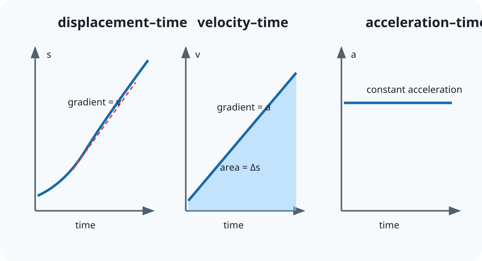

# 3.4 More Velocity-Time Graphs

[[00 3 Forces and Motion Index|Topic index]] · [[00 Course Index|Course index]] · ← [[3.3 Acceleration|3.3 Acceleration]] · [[3.5 Equations of Motion|3.5 Equations of Motion]] →

> [!summary] Lesson purpose
> This lesson develops motion graphs.
> Source: [3.4 More Velocity-Time Graphs.pptx](<../../All Powerpoints/3 Forces and Motion/3.4 More Velocity-Time Graphs.pptx>) · 21 slides

> [!method] Calculation routine
> Use [[Equation Solving Method]]: list known quantities, convert to SI, state the equation, rearrange, substitute with units, and round at the end.

## Core notes

### Velocity-time graphs

*Source slide 3.*

- Last lesson we saw that the gradient of a [[Glossary#Velocity|velocity]] time graph is the [[Glossary#Acceleration|acceleration]].

### Determining the Area

*Source slide 4.*

- Remember [[Glossary#Displacement|displacement]] is a [[Glossary#Vector|vector]] quantity.

### Distance Travelled

*Source slide 5.*

- Split into rectangles and triangles.

### Non-linear velocity-time graphs

*Source slide 7.*

- For your exam you will need to ‘count squares’ to determine the area under the curve.
- You will count a square if the majority of the square is under the curve.

## Equations

### Motion graphs

$$\text{gradient of }s\text{-}t=v$$

Velocity is the displacement-time gradient.

$$\text{gradient of }v\text{-}t=a$$

Acceleration is the velocity-time gradient.

$$\Delta s=\int v\,dt$$

Displacement is signed area under a velocity-time graph.

See [[Formula Sheet]] for the complete course formula set.

## Method

1. For an instantaneous gradient, draw a tangent at the required point.
2. For area, divide the region into simple shapes or count signed squares.
3. Area below the time axis is negative displacement.

## Common mistakes

- The area under a displacement-time graph is not a standard motion quantity.
- A horizontal line on a velocity-time graph means constant velocity, not rest unless the line is at zero.

## Additional examinable detail from the slides

> [!info]
> These collapsed slide notes retain assessable definitions, explanations, PowerPoint calculation steps, source tables and useful speaker-note detail that are not already stated in the concise sections above. Classroom administration, duplicate prompts, source credits and raw numerical answer lines are omitted.

> [!note]- Slide 3: Velocity-time graphs
> - For a velocity-time graph:
> - Gradient = acceleration
> - Today we will look at the area under the curve for a v-t graph.

> [!note]- Slide 4: Determining the Area
> - Area = velocity x time
> - Therefore,
> - Displacement = velocity x time

> [!note]- Slide 5: Distance Travelled
> - Area = base x height
> - Area = 10 m s⁻¹ x 10 s
> - Area = 100 m
> - Area = 0.5 x base x height
> - Area = 0.5 x 10 m s⁻¹ x 10 s
> - Area = 50 m

> [!note]- Slide 6: Distance Travelled
> - A-B, B-C, C-D

> [!note]- Slide 8: Negative Velocities
> - How would you determine from this graph the:
> - HINT: Remember negative velocities means that you are going backwards (you have changed direction).

> [!note]- Slide 10: Negative Velocities
> - 6 m + 6 m = 12 m
> - 6 m – 6 m = 0 m

> [!note]- Slide 15: Homework Answers
> - When t < 75 s: Largest constant positive acceleration.
> - When t > 75 s and t < 125 s: Constant velocity
> - When t > 125 s: Constant positive acceleration.

> [!note]- Slide 16: Homework Answers
> - Distance travelled is the total area under the curve.

> [!note]- Slide 19: Homework Questions
> - The ball has constant negative acceleration.

> [!note]- Slide 20: Homework Questions
> - Distance is the area under the curve

## Source slide route

> [!info]- Expand the original lesson sequence
> - 1. 3.4 More Velocity-Time Graphs
> - 2. Outcomes
> - 3. Velocity-time graphs
> - 4. Determining the Area
> - 5. Distance Travelled
> - 7. Non-linear velocity-time graphs
> - 8. Negative Velocities
> - 11. Homework Questions
> - 14. Answers
> - 15. Homework Answers
> - 19. Homework Questions

## Related reference notes

- [[Glossary]]
- [[Formula Sheet]]
- [[SI Units, Prefixes and Significant Figures]]
- [[Graphs, Gradients and Data Skills]]
- [[Practical Skills and Uncertainties]]
