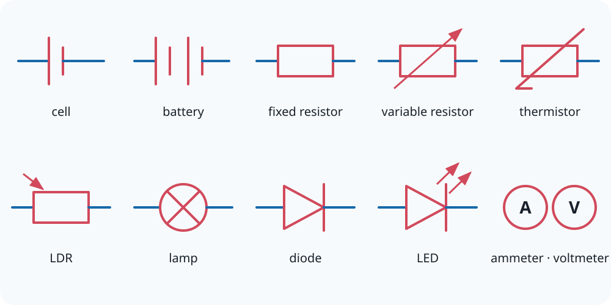

# 9.1 Circuit Symbols

[[00 9 Energy, Power, and Resistance Index|Topic index]] · [[00 Course Index|Course index]] · ← [[8.5 Charge and Current Summary|8.5 Charge and Current Summary]] · [[9.2 Potential Difference and Electromotive Force|9.2 Potential Difference and Electromotive Force]] →

> [!summary] Lesson purpose
> This lesson develops circuit symbols and measurement.
> Source: [9.1 Circuit Symbols.pptx](<../../All Powerpoints/9 Energy, Power, and Resistance/9.1 Circuit Symbols.pptx>) · 30 slides

> [!method] Calculation routine
> Use [[Equation Solving Method]]: list known quantities, convert to SI, state the equation, rearrange, substitute with units, and round at the end.

## Core notes

### Circuit Diagrams

*Source slide 6.*

- All electrical components have a circuit symbol from filament lamps to capacitors and diodes.
- All filament lamps have the same symbol regardless of the lamps [[Glossary#Power|power]] rating.
- Do not leave any gaps in the wires.

### Cells, batteries and Power Supplies

*Source slide 7.*

- Circuits require a form of [[Glossary#Energy|energy]] for their components to work.
- This is usually supplied through the use of cells, batteries, and power supplies.

### Cell and Battery Polarity

*Source slide 8.*

- Cells and batteries have two terminals.
- A positive and negative terminal.
- The order of this is called polarity.
- It is important to understand polarity as certain electrical components, such as diodes and LEDs, depend on polarity.

## Method

1. Use standard circuit symbols and draw connecting wires with straight lines.
2. Connect an ammeter in series with the branch being measured.
3. Connect a voltmeter in parallel across the component being measured.

## Common mistakes

- An ideal ammeter has negligible resistance; an ideal voltmeter has extremely large resistance.

## Additional examinable detail from the slides

> [!info]
> These collapsed slide notes retain assessable definitions, explanations, PowerPoint calculation steps, source tables and useful speaker-note detail that are not already stated in the concise sections above. Classroom administration, duplicate prompts, source credits and raw numerical answer lines are omitted.

> [!note]- Slide 1: 9.1 Circuit Symbols
> - A copper wire has a diameter of 2 mm and number [[Glossary#Density|density]] of 8.5 x 1028 m-3 .
> - The electrons are travelling with a speed of 4.68 x 10-7 ms-1.
> - You will need to use the

> [!note]- Slide 2: r
> - Step Three: Subtitle into equation
> - I = 0.0199… A
> - I = 2 x 10-2 A (1 sf)

> [!note]- Slide 5: Guglielmo Marconi – Father of wireless communication
> - Circuit symbols allowed him to patent his work for which he became a very wealthy man.

> [!note]- Slide 7: Cells, batteries and Power Supplies
> - A cell is a single component:
> - A battery is multiple cells:
> - Power supplies can be variable:

> [!note]- Slide 8: Cell and Battery Polarity
> - I’m tall and positive!

> [!note]- Slide 9: Polarity and Current
> - Electron Flow

## Source slide route

> [!info]- Expand the original lesson sequence
> - 1. 9.1 Circuit Symbols
> - 2. r
> - 4. Outcomes
> - 5. Guglielmo Marconi – Father of wireless communication
> - 6. Circuit Diagrams
> - 7. Cells, batteries and Power Supplies
> - 8. Cell and Battery Polarity
> - 9. Polarity and Current
> - 10. Resistors
> - 11. Mini-Plenary
> - 21. What is wrong?
> - 22. Homework Questions
> - 23. Answers
> - 24. Homework Answers

## Related reference notes

- [[Glossary]]
- [[Formula Sheet]]
- [[SI Units, Prefixes and Significant Figures]]
- [[Graphs, Gradients and Data Skills]]
- [[Practical Skills and Uncertainties]]
